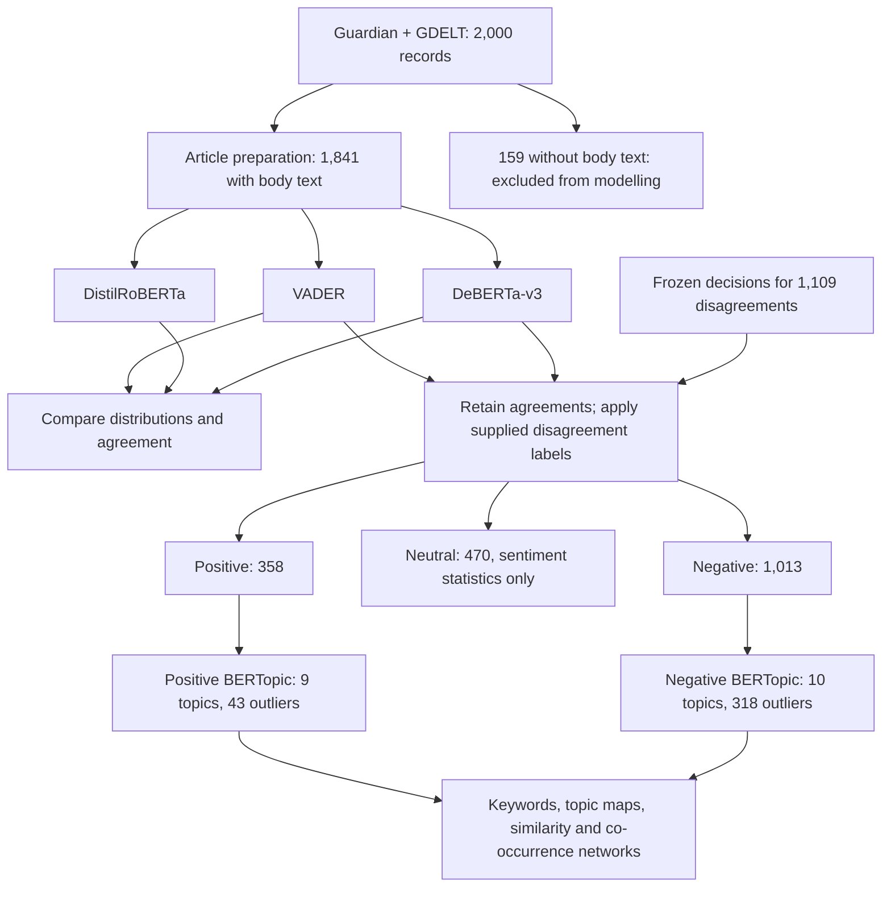

# Australia AI News: Sentiment and Topic Analysis

Code for the central computational workflow of an Australian-context news study:

**Guardian + GDELT collection → article preparation → three sentiment classifiers → final sentiment groups → separate Positive/Negative BERTopic models → keyword and topic visualisation.**

The saved study corpus has 2,000 records. The 1,841 records with usable body text enter sentiment modelling; the other 159 remain in the prepared corpus. DistilRoBERTa is a comparison model. Final groups retain VADER–DeBERTa agreements and use supplied decisions for disagreements. Neutral articles remain in the sentiment results and do not enter BERTopic.

## Main workflow



## What the model comparison establishes

VADER and DeBERTa assign the same class to 732 of 1,841 articles (39.8%) and different classes to 1,109. These are agreement counts: agreement does not establish correctness, and disagreement does not identify which model is correct. DistilRoBERTa contributes to the comparison, not to final-label voting.

The study does not establish which classifier is most accurate on this corpus. There is no separate independent reference-label evaluation, and corpus-level accuracy, precision, recall and F1 are not reported. Final labels are saved analysis inputs used for grouping articles, not independent ground truth for scoring the classifiers. The main comparative finding is that the same articles produce markedly different sentiment distributions under different classifiers.

## Start with the saved results

Clone the repository and run from its root. The following commands need neither news article text nor transformer weights:

```bash
git clone https://github.com/mike-0321/australia-ai-news.git
cd australia-ai-news
python -m venv .venv
source .venv/bin/activate
python -m pip install -r requirements.txt
python scripts/04_compare_models.py \
  --vader data/reference/vader.csv \
  --distilroberta data/reference/distilroberta.csv \
  --deberta data/reference/deberta.csv \
  --expect-rows 1841
python scripts/reproduce_reference.py
```

Model comparisons are written to `results/comparison/`. Recomputed sentiment distributions, topic coverage, and charts are written to `results/reproduced/`.

| Classifier / final labels | Negative | Neutral | Positive |
| --- | ---: | ---: | ---: |
| VADER | 500 | 1 | 1,340 |
| DistilRoBERTa | 400 | 1,051 | 390 |
| DeBERTa-v3 | 1,091 | 445 | 305 |
| Final labels | 1,013 | 470 | 358 |

The saved topic models contain nine Positive topics and ten Negative topics. Topic `-1` contains 43 Positive and 318 Negative outliers and is retained in coverage tables.

## Run the workflow on article text

Provide `data/input/articles.csv` using the [data schema](docs/data.md), then install the modelling dependencies:

```bash
python -m pip install -r requirements-models.txt
python scripts/01_prepare_corpus.py
python scripts/02_run_vader.py
python scripts/03_run_transformers.py --model all
python scripts/04_compare_models.py
python scripts/05_build_final_groups.py
python scripts/06_fit_topics.py
python scripts/07_analyze_topics.py
```

Optional keyword networks for the paper's original Positive topic 4 and Negative topic 3 can be generated with `python scripts/07_analyze_topics.py --network positive:4 --network negative:3`. Use those IDs only with the original assignments; newly fitted models may number their clusters differently. Interactive HTML files and the underlying network tables are written to the analysis output directory.

Step 05 defaults to the frozen `data/reference/final_labels.csv`. This file belongs to the saved study corpus. For a different corpus, pass `--decisions path/to/decisions.csv` containing `dataset_id,final_sentiment_label`. Every VADER–DeBERTa disagreement needs a supplied decision; missing decisions stop the pipeline. DistilRoBERTa never determines the final groups.

Transformer inference downloads the two pinned model checkpoints if they are not cached. BERTopic downloads its sentence encoder. The complete model run requires substantially more memory and time than reproducing saved tables. `--device cpu`, `--device cuda`, or `--device mps` selects the sentiment inference device; `--limit 1` supports a small inference check.

The eight fictional records in `data/example/articles.csv` can exercise preparation and VADER:

```bash
python scripts/01_prepare_corpus.py \
  --input data/example/articles.csv --output data/processed/example/article_input.csv
python scripts/02_run_vader.py \
  --input data/processed/example/article_input.csv --output data/processed/example/vader.csv
```

This small example does not have enough articles for the paper's BERTopic cluster settings.

## Optional live collection

The collector reads `GUARDIAN_API_KEY` from the environment. Set it locally, then run:

```bash
python scripts/00_collect_news.py --dry-run
python scripts/00_collect_news.py
```

The default collection interval is 2016-01-01 through 2026-06-28. The final selection is exported to `data/input/articles.csv`. Historical GDELT candidate files can be supplied with repeated `--gdelt-input path/to/file.csv` options. Live services and available article bodies change; a new collection is not guaranteed to reproduce the saved corpus. The [data documentation](docs/data.md) describes the optional cache schema.

## Repository layout

```text
scripts/              Ordered preparation, sentiment, topic and plotting commands
collection/           Guardian/GDELT retrieval, expansion and corpus selection
config/               Topic model settings and explicit keyword normalisation
data/example/         Fictional input for a small local check
data/reference/       Saved IDs, predictions, final labels and topic assignments
results/reference/    Saved aggregate topic tables and paper counts
docs/                 Method, input/output schema and validation details
tests/                Checks for article identity, decisions and model processing
```

News bodies, raw responses, generated results and model weights are not bundled. Generated files are ignored by Git. See [method settings](docs/method.md) and [validation](docs/validation.md) for reproduction boundaries. Agreement and kappa describe consistency between predictions; they are not accuracy estimates. The corpus is dominated by The Guardian and does not represent all Australian news coverage.

The included real-data tables contain article IDs, model scores, final labels, topic IDs and aggregate topic statistics. They omit real article titles, summaries, bodies and URLs. The eight example records are fictional. Reproducing the saved summary tables works with the bundled references; rerunning text-based inference and keyword extraction requires the article inputs described in [the data schema](docs/data.md).

Run the local tests with:

```bash
python -m pip install -r requirements-dev.txt
python -m pytest -q
```
